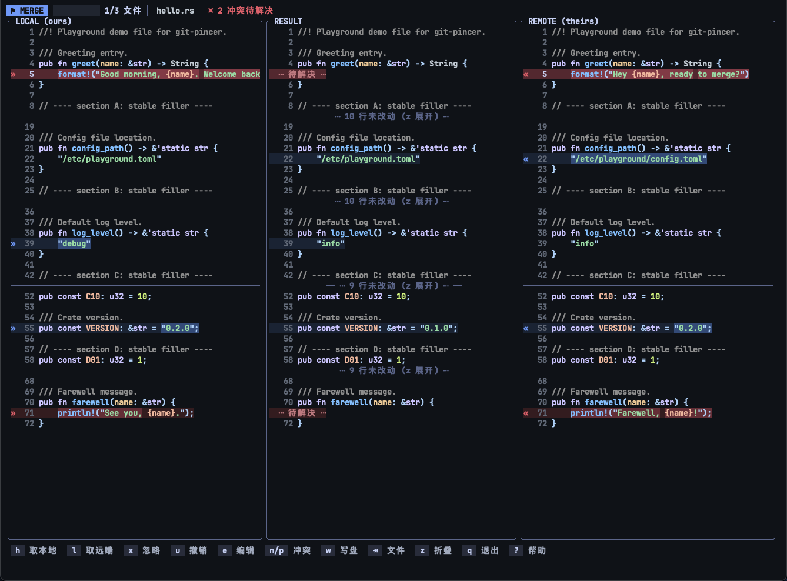

<p align="center">
  
</p>

<h1 align="center">git-pincer</h1>

<p align="center">
  <a href="https://github.com/zlx2019/git-pincer/actions/workflows/ci.yml"></a>
  <a href="https://crates.io/crates/git-pincer"></a>
  <a href="https://www.npmjs.com/package/git-pincer"></a>
  <a href="./LICENSE"></a>
  <a href="https://www.rust-lang.org"></a>
</p>

<p align="center">
  <b>English</b> · <a href="./README.zh-CN.md">简体中文</a>
</p>

<p align="center">
  <b>"Pincer"</b> — a Git terminal tool written in Rust, focused on helping developers resolve code conflicts in Git merge, rebase, cherry-pick and similar scenarios with ease.
</p>

The name comes from Rust's mascot — the crab. A Git conflict is like two branches "pinching" the same piece of code at the same time, while a crab's pincer stands for stability, precision and control. May it work like a trusty pincer: gripping both sides of every conflict firmly, helping you understand the differences and complete the merge more efficiently.



## Features

- **Three-pane merge UI** — local | result | remote, with chunks colored like IDEA: blue = modified, green = added, gray = deleted, red = conflict. The color fades once a chunk is resolved.
- **Precise diff rendering** — delta-style word-level emphasis inside changed chunks, plus syntax highlighting chosen by file extension (turned off for huge files).
- **Full flow takeover** — once every file is resolved it runs `git add` and the matching `--continue`, then re-checks and repeats until the repository is clean, so multi-commit cherry-picks and multi-round rebases just work.
- **RPG-style action menu** — bare `git-pincer` in a clean repository opens a pixel-art menu: pick an action, then a branch (merge / rebase / switch) or a commit (cherry-pick / revert). A status window maps your repository to character stats (Lv. = commits, HP = uncommitted changes, MP = stashes, EXP = commits ahead), and results appear as in-TUI dialogs — no flicker, no exit.
- **Broad conflict-source support** — merge, rebase, pull, cherry-pick, revert, `git am`, and flows without a `--continue` such as `stash pop`, `checkout -m` or `apply --3way`.
- **Native git, zero magic** — shells out to your git binary (the route lazygit and IDEA take), so credentials, hooks, merge strategies and rerere follow your existing configuration. Arguments are passed as arrays (no shell) and host `GIT_DIR`-style variables are scrubbed, so nested calls from hooks can't hit the wrong repository.
- **Terminal-aware theming** — dark (Tokyo Night) and light (Maple Light) themes via `--theme <auto|dark|light>`, `COLORFGBG` auto-detection, and xterm-256 quantization on terminals without truecolor.
- **Bilingual UI** — English and Chinese, chosen with `--lang <auto|zh|en>` (`auto` follows the system locale). Messages are embedded at compile time, so it is still a single binary.
- **Sensible fallbacks** — binary conflicts degrade to whole-file pick-one; a git-free `file` mode parses conflict markers directly; non-TTY invocations fail with a readable message instead of a panic.

## Installation

Requires `git` on your `PATH`.

```bash
cargo install git-pincer
```

Or via npm (prebuilt binary, no Rust toolchain needed):

```bash
npm install -g git-pincer
```

Prebuilt binaries for major platforms are also attached to [GitHub Releases](https://github.com/zlx2019/git-pincer/releases). To build from source (Rust 1.96+):

```bash
cargo install --git https://github.com/zlx2019/git-pincer
```

## Usage

```bash
git-pincer                      # conflicts present: take over and resolve them
                                # clean repo: open the interactive action menu
git-pincer merge <branch>       # run git merge, resolve conflicts if any
git-pincer rebase <branch>      # run git rebase, looping through every conflicted commit
git-pincer pull origin main     # arguments are passed straight to git pull
git-pincer cherry-pick <commit> # multiple commits / options are passed through
git-pincer revert <commit>      # run git revert and take over the conflicts
git-pincer switch [branch]      # switch branches; remote ones get a local tracking branch (no arg opens a picker)
git-pincer file conflict.txt    # git-free: parse a conflict-marked file, write it back
git-pincer abort                # abort the operation in progress (with confirmation)
git-pincer completions zsh      # shell completion script (bash/zsh/fish/powershell/elvish)
```

Tab completion needs a one-time hook into your shell:

```bash
# zsh
echo 'eval "$(git-pincer completions zsh)"' >> ~/.zshrc
# bash
echo 'eval "$(git-pincer completions bash)"' >> ~/.bashrc
# fish
git-pincer completions fish > ~/.config/fish/completions/git-pincer.fish
```

Global options:

| Option | Description |
| ------ | ----------- |
| `-C, --repo <PATH>` | Operate on the repository at `PATH` (defaults to the current directory) |
| `--theme <auto\|dark\|light>` | UI theme; `auto` inspects `COLORFGBG` and falls back to dark |
| `--lang <auto\|zh\|en>` | UI language; `auto` follows the system locale (Chinese locales get Chinese, everything else English) |
| `-v, --verbose` | Echo every git command being executed |

### Configuration

An optional config file is read from `~/.config/git-pincer/config.toml` (`$XDG_CONFIG_HOME` is respected; `%APPDATA%\git-pincer\config.toml` on Windows; the `GIT_PINCER_CONFIG` env var overrides the path entirely). CLI flags always take precedence. A missing file just means defaults; a malformed one fails fast with a readable error.

```toml
[ui]                    # defaults for the global options above
theme = "auto"          # auto | dark | light
lang = "auto"           # auto | zh | en
verbose = false
editor = "nvim"          # editor for the e key; falls back to $VISUAL > $EDITOR > vim > vi (notepad on Windows)

[keys]                  # rebind actions — replaces all default keys of that action
take-local = "o"
write = "ctrl+s"        # modifiers: ctrl+ / alt+ / shift+; named keys: left, up, tab, enter, space, f1-f12…

[theme.dark]            # override any color by name (same table exists as [theme.light])
rpg_accent = "#ff7a2f"
band_conflict = ["#3a1e22", "#5e2d35"]   # band_* / emph_* colors take a [normal, selected] pair
```

Rebindable actions: `take-local`, `take-remote`, `ignore`, `undo`, `undo-file`, `edit`, `apply-all`, `next-change`, `prev-change`, `next-conflict`, `prev-conflict`, `scroll-down`, `scroll-up`, `scroll-left`, `scroll-right`, `copy-chunk`, `copy-file`, `copy-local`, `copy-remote`, `write`, `next-file`, `fold`, `quit`, `help`. Overridden keys show up in the hint bar and help overlay automatically. Unknown action names, key conflicts and invalid colors are rejected at startup with the full list of valid values.

Try the TUI without a git repository:

```bash
cp fixtures/conflict.txt /tmp/ && git-pincer file /tmp/conflict.txt
```

### Keybindings

| Key | Action |
| --- | ------ |
| `h` / `←` | Take the local side (taking both sides of a conflict in order keeps both) |
| `l` / `→` | Take the remote side |
| `x` | Ignore the remaining pending sides of the current chunk (keep base) |
| `u` | Undo all decisions on the current chunk |
| `U` | Undo all decisions in the current file |
| `e` | Edit the current chunk in `$EDITOR` |
| `a` | Apply every non-conflicting change at once |
| `j` / `k` | Move to the next / previous change chunk |
| `n` / `p` | Jump to the next / previous unresolved conflict |
| `Ctrl+d` / `Ctrl+u` | Scroll the viewport half a page down / up (navigation keys re-attach it to the cursor) |
| `<` / `>` (or `Shift+←` / `Shift+→`) | Pan all three panes left / right on long lines (`…` marks clipped content) |
| `y` / `Y` | Copy the current chunk result / the whole file result |
| `H` / `L` | Copy the local / remote side of the current chunk |
| `w` | Write the file (auto-applies remaining non-conflict changes, then `git add`) |
| `Tab` | Switch to the next file |
| `z` | Fold / unfold unchanged regions |
| `q` | Quit (press twice if files are unfinished; the scene is kept) |
| `?` | Show the full key reference |

### Supported conflict sources

| Source | Detected via | Finished with |
| ------ | ------------ | ------------- |
| `git merge` / `git pull` | `MERGE_HEAD` | `git merge --continue` |
| `git rebase` | `rebase-merge` / `rebase-apply` | `git rebase --continue` (multi-round) |
| `git cherry-pick` | `CHERRY_PICK_HEAD` | `git cherry-pick --continue` (multi-round) |
| `git revert` | `REVERT_HEAD` | `git revert --continue` |
| `git am -3` | `rebase-apply/applying` | `git am --continue` |
| `stash pop` / `checkout -m` / `apply --3way` | unmerged index entries only | nothing to continue — resolving is enough |

## How it works

- **diff3 core** — two 2-way diffs (base→ours, base→theirs, Myers algorithm with a 500 ms timeout guard) are grouped by base-range collisions into chunks: stable, one-sided, agreed, or conflicting. The grouping is deliberately conservative: reporting one conflict too many beats merging something silently wrong.
- **Pure-logic session** — every chunk side is pending / applied / ignored; take order defines how content is stitched together, and `$EDITOR` edits override a chunk wholesale. Files containing NUL bytes degrade to a whole-file binary choice.
- **Thin git wrapper** — conflict contents are read from index stages 1/2/3; writes go through `git add`; repository state (merge / rebase / cherry-pick / revert / am) is probed from the git directory so the right `--continue` is always used.

## Development

```bash
cargo nextest run --all-features --no-tests pass   # tests
cargo clippy --all-targets --all-features -- -D warnings
cargo fmt --all -- --check
```

See [CONTRIBUTING.md](./CONTRIBUTING.md) for the toolchain setup, pre-commit hooks and commit conventions.

## Acknowledgements

Built with [ratatui](https://github.com/ratatui/ratatui), [similar](https://github.com/mitsuhiko/similar), [syntect](https://github.com/trishume/syntect) and [clap](https://github.com/clap-rs/clap). Visual design inspired by the IntelliJ IDEA merge tool, [delta](https://github.com/dandavison/delta) and [lazygit](https://github.com/jesseduffield/lazygit).

## License

Distributed under the [MIT](./LICENSE) license.
